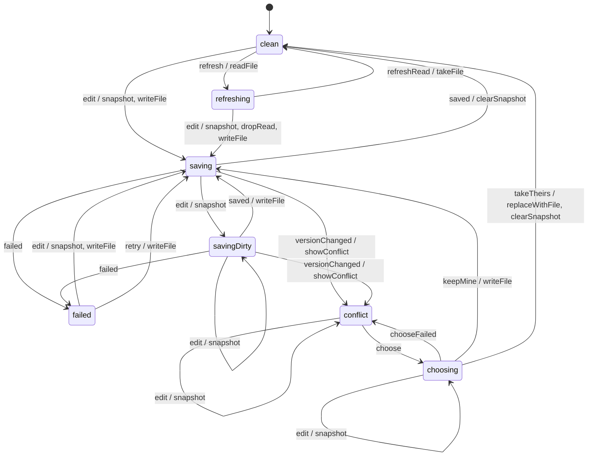

# Architecture

Taskite is one TypeScript code base with three hosts and a CLI. The browser, the NAS server's client and the Electron app run the same UI. The only thing that differs between them is where `tasks.json` comes from.

```
     ┌────────────────── apps/web (Preact + signals, one Vite build) ──────────────────┐
     │  App · Sidebar · TaskView · CommandMenu · ContextMenu · Dialogs · StatusBar      │
     │  AppController (view, choice, dialogs, notices) · commands.ts (the catalog)       │
     └───────────────────────────────────────┬──────────────────────────────────────────┘
                                             │ imports
     ┌──────────────────── packages/ui (Preact + signals) ──────────────────────┐
     │  CommandCatalog (keys, two-key sequences, recents) · Dialog · icons       │
     │  TaskSession (saving, retries, conflicts, recovery)                       │
     │  TaskStore ─┬─ BrowserStore  (the browser's private file system)          │
     │             ├─ NasStore      (fetch /api/data, ETag)                      │
     │             ├─ NativeStore   (window.taskiteNative IPC)                   │
     │             └─ MemoryStore   (tests)                                      │
     └───────────────────────────────────────┬──────────────────────────────────┘
                                             │
     ┌──────────────────── packages/core (pure TS) ────────────────────┐
     │  model (normalize, serialize) · TaskList (changes, undo)         │◄──── apps/cli
     │  parser (Quick Add) · dates and recurrence · views · selection   │
     └──────────────────────────────────────────────────────────────────┘
     ┌──────────── packages/node-files (Node) ────────────┐
     │  readDataFile · writeDataFile (atomic, versioned)  │◄──── apps/desktop, apps/server, apps/cli
     └────────────────────────────────────────────────────┘
```

## Layering

- `packages/core` has no DOM and no Node APIs. ESLint rejects `window`, `document`, `localStorage` and `process` there, so the engine runs the same in a browser, the CLI and the tests.
- `packages/ui` knows the DOM but not where the file lives: it only sees a `TaskStore`.
- `packages/node-files` is the only code that touches the disk. The desktop app, the server and the CLI share it, so they all save the same way.
- Other packages import only through `@taskite/<package>`; ESLint rejects deep imports.

## Core (`packages/core`)

- `model.ts`: the file format (PRD §3.1). `normalize` fills in missing or wrong fields so older and hand-edited files load; `serialize` writes it back pretty-printed.
- `taskList.ts`: every change to tasks, projects and labels, each one an undo step (PRD §4.7).
- `parser.ts`: Quick Add (PRD §4.2). `dates.ts`: due dates and recurrence. `views.ts`: what each list shows and in what order (PRD §5.2). `selection.ts`: choosing tasks (PRD §7).

## UI (`packages/ui`)

- `store/`: the `TaskStore` contract and its four adapters. A version is the SHA-256 of the file's text; a save sends the version it last saw and fails with `ConflictError` if the file changed (PRD §3.4). Each adapter also keeps attached files under their ids, written once, in an `attachments` folder beside the tasks file (PRD §4.8).
- `session/taskSession.ts`: one open file. It saves every change at once, never two saves at a time, retries a failed save, keeps unsaved text for recovery, and stops on a conflict until the user chooses. What happens when is the table in `session/saveChart.ts`, drawn below.
- `commands/`: the `CommandCatalog`. Shortcuts are parsed once; `forEvent` turns a key press into a command, a wait for the second key of a sequence, or nothing (PRD §8).
- `components/`: `Dialog` (modal, focus trap, Esc), `ListPopup` and the `Icon` set.

### Saving

Every move the save session can make, from `toMermaid()` in `session/saveChart.ts`; a test checks this drawing matches the table. An event with no arrow from the current state changes nothing. To review a change to saving, read this diagram's diff and ask what happens to typing in each state.



- `snapshot` keeps the data in the recovery slot at every edit, so a crash or a conflict never loses typing.
- `dropRead`: an edit during a refresh wins; the file read is ignored and the save finds any conflict.
- `takeFile` takes an outside change as one undo step; `replaceWithFile` (Use Theirs) drops this window's changes.
- `choosing`: a conflict choice is reading the file. The dialog's buttons wait, so a second click can't apply an old read to a later conflict; if the read fails, the dialog is back.

## Web (`apps/web`)

- `main.tsx` picks a store with `openStore.ts`: the native bridge in Electron, the NAS API when `/api/info` answers, else the browser's storage.
- `app/controller.ts`: the app's state as signals: the view, the chosen tasks, the open dialog, notices.
- `app/commands.ts`: every command. The command menu, shortcuts, the right-click menu (`TASK_MENU`), the native menu bar (`nativeMenu.ts`) and the Keyboard Shortcuts window (`shortcuts.ts`) all read it.

## Server (`apps/server`)

A `node:http` server with no framework. `GET` and `PUT /api/data` read and write `tasks.json` with `ETag` and `If-Match`, `POST /api/copies` keeps a dated copy, `/api/attachments/<id>` stores and sends attached files, and everything else is a static file from the web build, never from outside it. It checks a bearer token, or the `Host` header when there is no token (PRD §10). The `Dockerfile` builds the web client and runs the server as the `node` user with the data in `/data`.

## Desktop (`apps/desktop`)

- `main.ts`: one window, loading the web build from `app://taskite/`. The renderer is sandboxed with context isolation, and IPC is accepted only from that origin.
- `preload.cts` exposes `taskiteNative`: load, save and save a copy of the tasks file, write, read and clean up attached files, set the menu bar, send menu commands and full-screen changes to the page, and say whether the window uses the unified toolbar (`chrome`; macOS). `main.tsx` turns that into the `tk-unified` and `tk-fullscreen` classes on `<html>`, which the stylesheet uses for the drag regions. The channels are listed in `bridge.ts`.
- `paths.ts`: where the data lives, and the one-time read of the old Tasks file. `menu.ts`: the menu bar from the catalog plus the standard menus, and the edit menu for right-clicked text. `windowState.ts`: the window's size and place.

## CLI (`apps/cli`)

`args.ts` parses the command line, `cli.ts` runs a command against `packages/core` and `packages/node-files`, and `io.ts` finds the file. `runCli` takes its input and output as arguments, so the tests run it without a process.

## Testing

Vitest runs every package's `test/` folder in Node. The store adapters share one contract test; the web app's tests drive the `AppController` and the catalog against a `MemoryStore`; `controls.test.ts` checks [Controls](controls.md) against the catalog. UI changes are also checked in a headless browser or the headless desktop app (see [Development](development.md#checking-your-work)).
