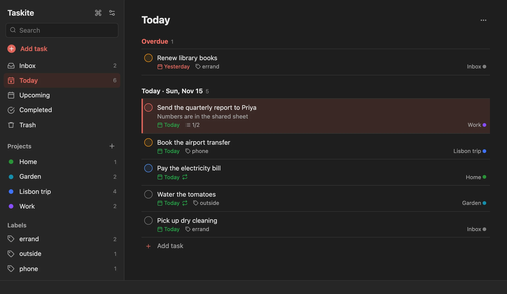

# Features

Taskite is a to-do list for one person, on one file. The desktop app, the browser, the NAS server and the command line all read and write the same `tasks.json`. The exact behaviour of each feature is in the [product requirements](plans/prd.md).

## Quick Add

Press `Q` (or click **Add task**) and type a task in one line. Taskite pulls out:

| You type                                                                        | It means                               |
| ------------------------------------------------------------------------------- | -------------------------------------- |
| `today`, `tomorrow`, `friday`, `next week`, `in 3 days`, `Dec 25`, `2026-11-01` | The due date                           |
| `every day`, `every weekday`, `every week`, `every month`, `every monday`       | Repeats                                |
| `p1` to `p4`                                                                    | Priority (1 is urgent)                 |
| `#Home`                                                                         | The project (made for you if it's new) |
| `@phone`                                                                        | A label (as many as you like)          |

The row previews the date, project and labels while you type. Press Enter to add the task and start the next one; press Enter on an empty row, or Esc, to stop. A task added in a project, on a day in Upcoming or under a label starts with that project, date or label.

## Views

- **Inbox** and each **project** list their open tasks in the order you choose. Drag a task to reorder it.
- **Sections** split a project into named groups, such as To do, Doing and Done. Add one from the project's ⋯ menu; right-click a section's heading to rename, move or delete it. **View as Board** shows the sections as columns side by side. Drag tasks between sections, or use `⌥←` and `⌥→`.
- **Today** lists what's due today, with anything overdue above it.
- **Upcoming** shows the rest of this week one day at a time, then next week, then everything later. Weeks start on the day your system's region starts them.
- **Labels** list every open task with that label. Right-click a label to rename it or give it a colour.
- **Completed** lists finished tasks under the day you finished them.
- **Search** (`/`) finds tasks by their name, description or labels, finished ones included.

Drop a task on a project, a label, Today or the Trash in the sidebar to move it there, give it that label, make it due today or delete it.

## Working on tasks

- **Complete** a task with its circle or Space. A repeating task moves to its next date instead, and says when that is.
- **Edit** a task (click it, or Enter) to change its name, description, date, repeat, priority, project, labels and subtasks. Changes apply as you make them (each one can be undone), and fields the task doesn't use stay out of the way until you add them with **+ Add**.
- **Set a due date** with `D`: type it ("fri", "jan 5") or pick a day on the month calendar, where today is ringed.
- **Subtasks** are one level deep. Completing a task completes its subtasks; reopening a subtask reopens its parent.
- **Choose several tasks** with Shift and the arrow keys, ⌘-click or Shift-click, then complete, date, prioritise, move or delete them all at once.
- **Reorder** the chosen tasks with `⌥↑` and `⌥↓` in the Inbox and projects. A task moves with its subtasks.
- **Right-click** a task, the empty part of a list, or a project, label, Completed or the Trash in the sidebar for the actions that fit it. Text fields get Cut, Copy, Paste and spelling suggestions.

## Never losing a task

- Every change saves at once. If a save fails, Taskite tries again, keeps your changes in the browser's storage, and shows **Try again** until it works. If the app closes first, it offers to restore them next time.
- Every change can be undone (`⌘Z`) and redone (`⇧⌘Z`), up to 100 steps.
- Deleted tasks go to the **Trash** for 30 days. Restore them with `R`.
- If the file changed somewhere else (another window, another computer, the CLI) while you had changes, Taskite stops and asks: **Save Mine as a Copy** (keeps both, the default), **Keep Mine**, or **Use Theirs**. Nothing is merged or overwritten without asking.
- A file that can't be read is copied aside, never deleted.

## Commands and shortcuts

Every action is a command. Find any of them with the command menu (`⌘K`) by its name or another word for it, with or without spaces, which also jumps to a project or label and moves the chosen tasks. The menu bar, the right-click menu and the **Keyboard Shortcuts** window (`?`) all come from the same list. See [Controls](controls.md).

## Look

A light and a dark theme, or follow the system (**Settings**, `⌘,`). Nothing animates when the system asks for reduced motion. Messages appear in the status bar at the bottom, with Undo where it helps.

## Desktop, browser, NAS and CLI

- **Desktop** (macOS, Windows, Linux): keeps the tasks file in the app's data folder, and remembers the window's size and place.
- **Browser**: keeps the tasks in the browser's private storage.
- **NAS**: a small Docker image serves the app and one tasks file, behind a token. Open it from any browser on your network. See [Getting started](getting-started.md#run-it-on-a-nas-docker).
- **CLI**: `taskite list`, `add`, `done` and more, on the desktop app's file or any other, with `--json` for scripts and agents. See [Getting started](getting-started.md#the-taskite-command-line).
